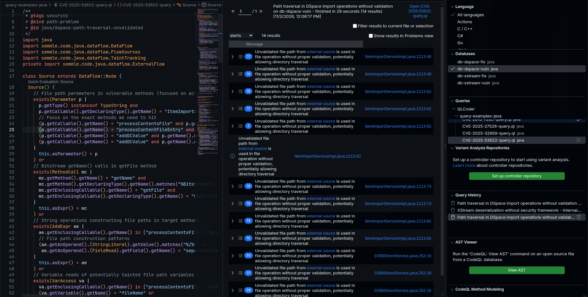

I asked [Professor Dutta](https://www.cs.cornell.edu/~saikatd/) to be a part of his research group, I had originally been interested because I noticed he had some background with LLM-assisted fuzzing ([FlashFuzz](https://arxiv.org/abs/2509.14626)), and he also worked with creating LLM-assisted CodeQL queries ([QLCoder paper](https://arxiv.org/abs/2511.08462)). I find this work fascinating, and also to be the new frontier in agentic vulnerability discovery and making truly secure code (alongside [formal verification](https://www.zellic.io/blog/x86-formal-verification-intro/), which btw if it's able to scale will be huge). After our brief conversation, he tasked me with going through some of the example queries generated by the [QLCoder project](https://github.com/neuralprogram/QLCoder) and evaluating them for overfitting.

QLCoder is an agentic framework that takes a CVE and has an LLM write a CodeQL query to detect it. The LLM gets the CVE's metadata and the fix diff, then keeps refining the query based on how it runs, with the CodeQL language server and a RAG database of docs and example queries to help.

He said that LLMs tend to overfit by making a query that passes its test by memorizing the case it was tested on, without trying to capture the overarching vulnerability class. An example analogy would be two robots learning to cross a warehouse. One robot learns to look for obstacles and steer around them. The other memorizes the moves from the one route it practiced on: forward twelve steps, turn left, forward three. On that route both are perfect, but move a single shelf and the second robot drives straight into it. QLCoder has the same problem with an extreme setup: each query is “trained” and graded on a single example, one CVE’s vulnerable and fixed versions. The validator only checks two things: does the query hit a target method on the vulnerable version, and does it avoid hitting one on the fixed version? A query can pass that test without understanding the bug.

I wanted to learn more about this issue, so I read [Do Machine Learning Models Memorize or Generalize?](https://pair.withgoogle.com/explorables/grokking/), this writeup really went into explaining the grokking phenomenon, where a model that has already fit its training data only starts to generalize much later. As I read I conjectured that perhaps this is the reason why projects like QLCoder produce overfitted results with LLMs. CodeQL is a fairly niche and under-utilized static analysis tool and the training corpus is simply too small for the models to properly generalize, so its queries will be overfit.

So, thus, I started evaluating the example queries included in the QLCoder project.

## Example 1: DSpace (CVE-2025-53622)

This CVE is a path traversal in DSpace's item import, and the fix adds path checks to `ItemImportServiceImpl` and `DSBitStoreService`.

From my understanding, CodeQL path queries usually ask whether data can get from a source (untrusted data input) to a sink (a dangerous operation) without passing by a safety check. So what you'd want to see for these type of queries is real untrusted input as the source, the dangerous operation as the sink, and a barrier that only stops the flow when a check is really on the path.

The query created for this vulnerability uses a method name that only exists in the fixed version to decide whether the vulnerability exists, which defeats the purpose of creating sound queries:

```ql
219  // Additional check: exclude flows where the validateFilePath method exists in the same class (fixed version)
220  not exists(Method validateMethod |
221    validateMethod.getName() = "validateFilePath" and
222    validateMethod.getDeclaringType() = sink.getNode().asExpr().getEnclosingCallable().getDeclaringType()
223  )
```

The validateFilePath method is a method from the fixed version, and this check drops a result whenever a method with that name exists in the same class as the sink, whether or not anything calls it. So if you give the vulnerable code an empty method with that name, the query thinks it's fixed. I added `private void validateFilePath() {}` to `ItemImportServiceImpl` and `DSBitStoreService` in the vulnerable version, never called it, and rebuilt the database. The query went from 14 results to 0, even though the bug is still there.

Moreover there are instances of hardcoding vulnerable methods.

```ql
42  ae.getEnclosingCallable().getName() in ["processContentsFile", "processContentFileEntry", "getFile", "addDCValue"] and
```

This same list shows up five times across `Source`, `Sink` and the final `where` clause (lines 42, 51, 66, 93 and 194). These are the four existing methods on the list the validator grades against (`data/fix_info.csv`), so the query only searches the places it gets graded on.



## Example 2: XStream (CVE-2013-7285)

This CVE is a remote code execution bug in XStream. An attacker controls the XML passed to `fromXML`, and since the XML carries type information they can get XStream to build a dynamic proxy around `java.beans.EventHandler` that runs a shell command.

This query is somewhat better than the DSpace one. It uses fully qualified class names and includes CodeQL's real untrusted input function (`ActiveThreatModelSource`), and this one uses the defense as a whole (`SecurityMapper`, `TypePermission`, `setupSecurity`). It passes the same test, with 9 results on the vulnerable version and 0 on the fixed version, but it's still overfit.

Like `validateFilePath`, part of `hasSecurityValidation` decides the fix is present by looking for something that only exists in the fixed version, and for this one it's an import:

```ql
 96  // Check if TypePermission classes are imported (indicating security framework usage)
 97  exists(ImportType imp |
 98    imp.getImportedType().getPackage().hasName("com.thoughtworks.xstream.security") and
 99    imp.getCompilationUnit() = ma.getEnclosingCallable().getDeclaringType().getCompilationUnit()
100  )
```

An import doesn't do anything at runtime. I added an empty `TypePermission` interface and an unused import of it to `XStream.java` in the vulnerable version, and the query went from 9 results to 0, like the last one. It doesn't capture the real fix either: at the fixed commit `setupSecurity()` still allows every type (`AnyTypePermission.ANY`), and what stops this payload is `ReflectionConverter` refusing to convert `EventHandler`, which the query never mentions.

The sink is overfit too:

```ql
75  // XStream setup methods that don't configure security
76  ma.getMethod().getDeclaringType().hasQualifiedName("com.thoughtworks.xstream", "XStream") and
77  ma.getMethod().hasName(["setupAliases", "buildMapperDynamically", "buildMapper"]) and
78  not hasSecurityMapperInChain(ma)
```

These are again names from the validator's target list for this CVE, and `buildMapper` and `buildMapperDynamically` are private methods of `XStream`. All 9 results are mapper setup calls inside `XStream.java` (lines 552 to 588). In 6 of them the source is an argument written in `XStream.java` itself, like `"com.thoughtworks.xstream.mapper.EnumMapper"`, and in the other 3 the source and sink are the same call.
